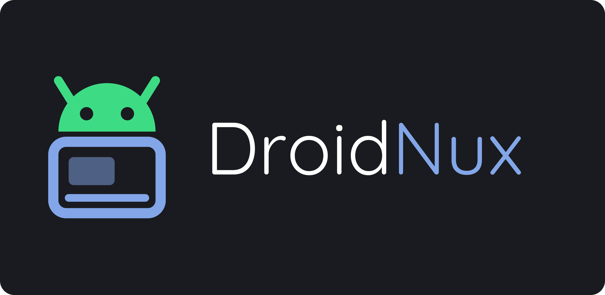
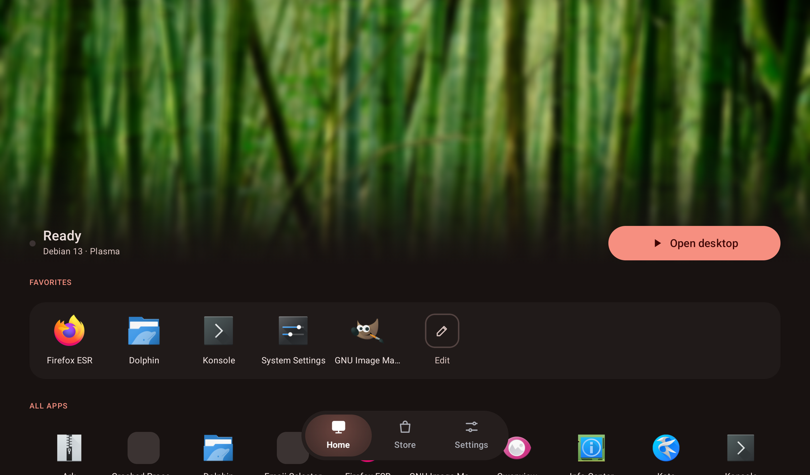
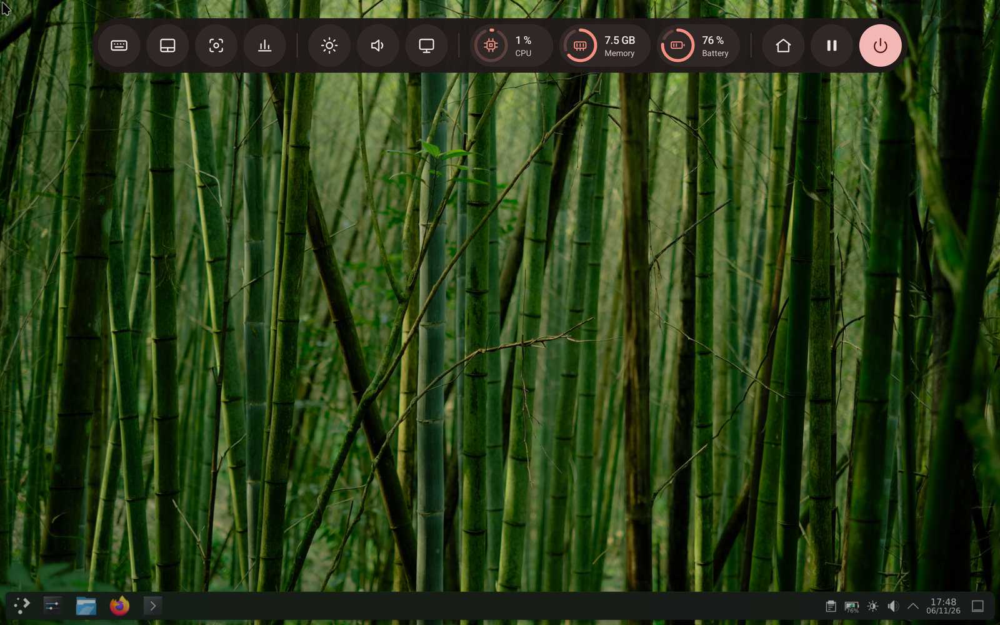
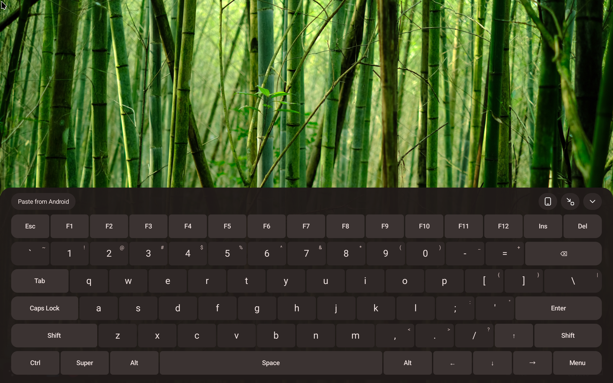
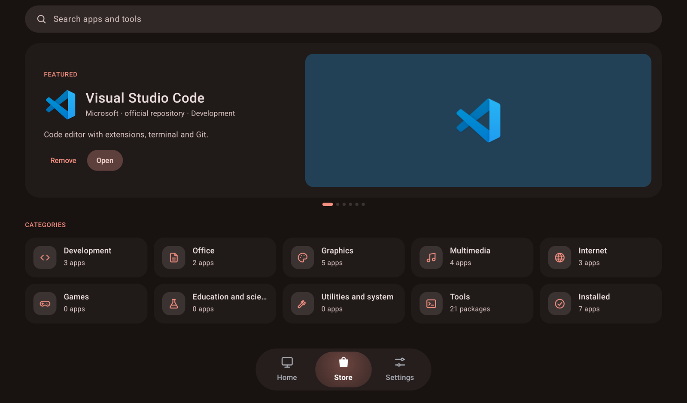
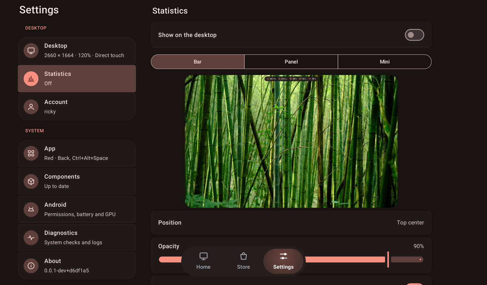
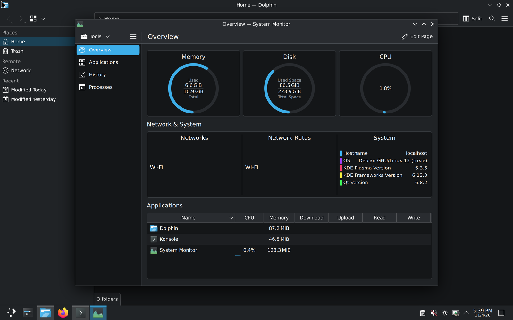

<p align="center">
  
</p>

DroidNux runs a real Linux desktop on Android without root: KDE Plasma on Debian, with the device's GPU, sound and
video decoding. Made for tablets first, then phones, with touch, keyboard and trackpad.

> [!WARNING]
> Early development, no release yet. Tested on a Galaxy Tab S9+ and a Galaxy S26 Ultra.

<p align="center">
  
</p>

## Features

- **Set up from the app:** a first-run wizard installs Debian 13 with Plasma 6.3 on Wayland, KDE's apps and the GPU
  drivers. No terminal needed.
- **Home, Store and Settings:** favorite apps, Debian's catalog of desktop apps, VS Code and command-line tools,
  Flatpak apps from Flathub. Linux apps can also go on Android's launcher.
- **GPU:** Vulkan (Turnip) and OpenGL (Zink) on Adreno, presented without copies at up to 120 fps. Firefox uses
  WebRender on the GPU; mpv and ffmpeg decode video in hardware (VA-API on MediaCodec). Flatpak apps get the GPU too.
- **Quick menu** (Back or Ctrl+Alt+Space): keyboard, trackpad, screenshot, statistics, brightness, volume, display,
  CPU, memory and battery, Home, pause and end.
- **Input:** touch, mouse, trackpad with pointer capture, physical keyboard with system keys, and a full PC keyboard
  on screen.
- **Android integration:** sound in and out, shared clipboard, the device's storage in the home folder, language,
  time zone, battery and network in Plasma.

## Screenshots

<p align="center">
  
  
</p>
<p align="center">
  
  
</p>
<p align="center">
  
</p>

## Requirements

- Android 10 or later, arm64.
- A Snapdragon (Adreno) GPU for hardware acceleration; other devices run without it.
- A few GB of free space.
- "Disable child process restrictions" in Android's developer options, or Android stops the desktop past 32
  processes. The app checks it.

## How it works

- **Container:** [Burrow](https://github.com/RickyTr99/burrow), DroidNux's own runtime, runs an unmodified Debian
  arm64. A seccomp filter traps the system calls that touch paths and users, and a signal handler emulates them in
  the same process: no ptrace, no root, about a microsecond per call. It also emulates what bwrap needs, so Flatpak
  works.
- **Display:** a native Wayland compositor in the app hosts KWin nested. KWin renders into Android hardware buffers
  that the app presents as they are.
- **Components:** Mesa (Turnip on KGSL, Zink, GBM) and patched KDE libraries, built by CI from `guest/` and
  downloaded by the app.
- **Sound:** a PipeWire module in the container sends audio to the app, which plays it with AAudio.

## Building

Requirements: JDK 21 and the Android SDK. Gradle installs the NDK and CMake from `gradle/libs.versions.toml`.

```sh
git clone --recurse-submodules https://github.com/RickyTr99/droidnux.git
cd droidnux
./gradlew assembleDebug
```

The APK is in `app/build/outputs/apk/debug/`. Only `arm64-v8a` is supported.

## Credits

- [Mesa](https://mesa3d.org/): Turnip and Zink
- [KDE Plasma](https://kde.org/plasma-desktop/), KWin and KDE Frameworks, patched in the Plasma component
- [Wayland](https://wayland.freedesktop.org/), [wayland-protocols](https://gitlab.freedesktop.org/wayland/wayland-protocols),
  [plasma-wayland-protocols](https://invent.kde.org/libraries/plasma-wayland-protocols) and
  [wlr-protocols](https://gitlab.freedesktop.org/wlroots/wlr-protocols)
- [libffi](https://sourceware.org/libffi/), MIT
- [PipeWire](https://pipewire.org/) headers, MIT
- [Debian](https://www.debian.org/) root filesystems from [debuerreotype](https://github.com/debuerreotype/docker-debian-artifacts)
- [Quicksand](https://github.com/andrew-paglinawan/QuicksandFamily) (OFL) in the banner

## License

DroidNux is licensed under the [GPL-3.0](LICENSE).

The Android robot in DroidNux's icon is reproduced or modified from work created and shared by Google and used
according to terms described in the [Creative Commons 3.0 Attribution License](https://creativecommons.org/licenses/by/3.0/).
